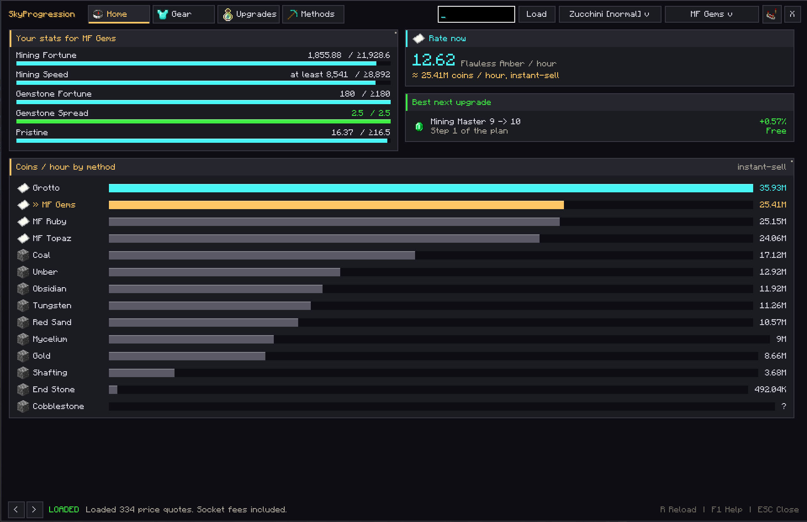
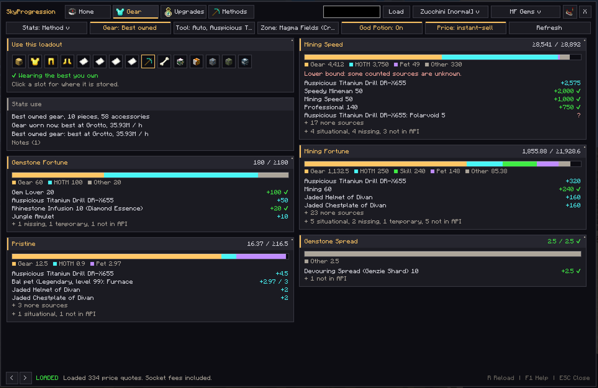
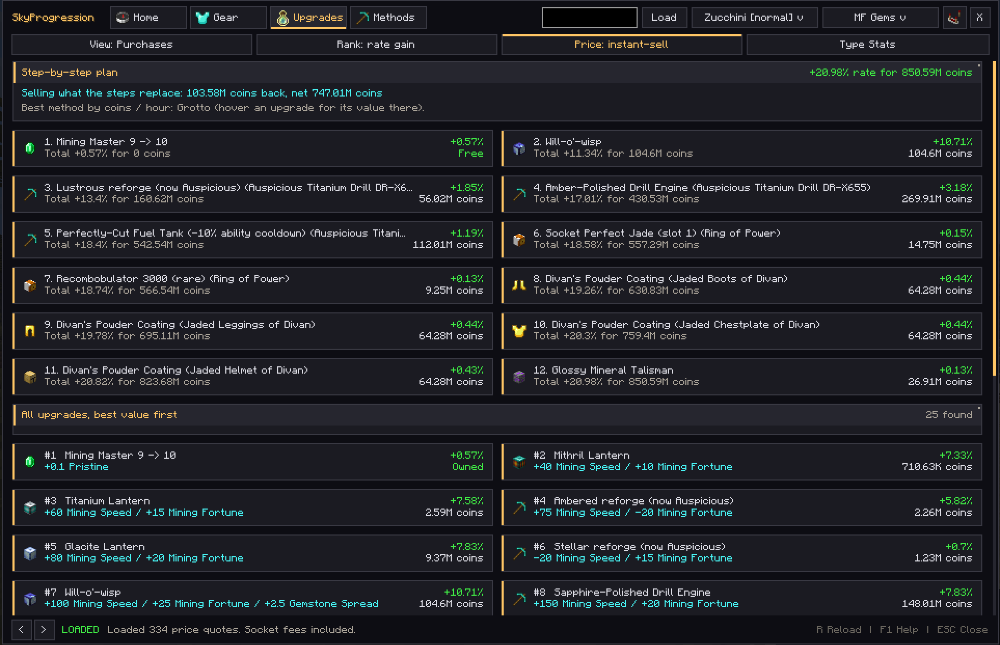
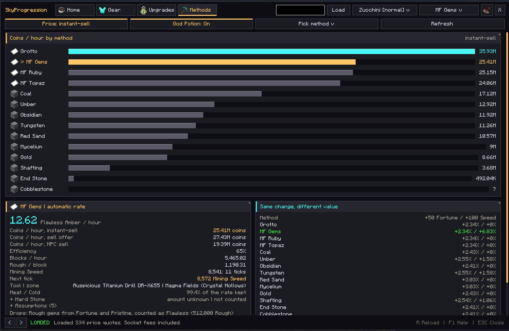

  <picture>
    <source media="(prefers-color-scheme: dark)" srcset="docs/brand/lockup-stacked-dark-bg.png">
    
  </picture>

  Hypixel SkyBlock mining progression, inside Minecraft. 
  Every stat broken down by source, your rate for each method, and the upgrades that raise it most per coin.

  
  
  
  

---

## Features

- **Stat breakdown.** Mining Fortune, Speed, Spread, Pristine, the type Fortunes, Wisdom, Breaking Power, ability
  cooldown, Heat/Cold Resistance and powder buffs, each split by source (gear, HOTM, skill, pet, accessories and more)
  next to the best value you could reach.
- **Rates for every method.** Magma Fields gems, Fairy Grotto, Coal, Obsidian, Tungsten, Umber, Glacite, Gold, End Stone,
  Cobblestone, Mycelium and Red Sand, modelled from block strength, tick thresholds, abilities, heat and cold.
- **Upgrades that matter.** Every upgrade ranked by how much it raises your rate per coin, a step-by-step plan, buy vs
  craft, and resale of what it replaces.
- **Start with what you own.** The best loadout you already have for a method, and where each piece is stored.
- **Session tracker.** Measures your real collection and coins per hour for the selected method (pickups, sack
  summaries, Pristine procs) next to the model, with active time and uptime; save sessions as JSON.
- **Compare methods.** Coins per hour across every method with your own gear (instant-sell, sell offer or NPC prices).

SkyProgression only gives advice. It never buys, equips or mines for you.

## Screenshots

| Home | Gear |
| --- | --- |
|  |  |
| **Upgrades** | **Methods** |
|  |  |

## Install

1. Install **Fabric Loader 0.20.1+** and **Fabric API** for Minecraft **26.1.1**, **26.1.2** or **26.2** (Java **25**).
2. From the [latest release](https://github.com/tianiste/SkyProgression/releases/latest), download the jar for your
   Minecraft version and put it in your `mods` folder:
   - 26.1.1 or 26.1.2: `skyprogression-<version>+26.1.1-26.1.2.jar`
   - 26.2: `skyprogression-<version>+26.2.jar`
3. In SkyBlock, turn on **SkyBlock Menu > Settings > API Settings > Inventory API**.
4. Type `/sp`. Your profile loads automatically.

No API key and no extra program are needed. Want to try it first? Press **Demo** for clearly labelled sample data.

More help, every tab explained and troubleshooting: [docs/SETUP.md](docs/SETUP.md). What changed: [CHANGELOG.md](CHANGELOG.md).

## How it works

All calculations run inside the mod. The hosted SkyProgression API at `api.skyprogression.dev`
([source](https://github.com/tianiste/SkyProgression-API)) only supplies your raw SkyBlock profile and current prices,
so no Hypixel key ever ships in the mod. Every formula and its source is documented in
[docs/CALCULATIONS.md](docs/CALCULATIONS.md). Unknown values stay unknown and are never treated as zero or free.

**Privacy.** The mod sends the UUID of the player you look up to the SkyProgression API. Profiles are cached there for up
to 30 minutes to save requests and are not stored afterwards. Other players' names are looked up at Mojang, and once per
launch the mod asks GitHub whether a newer release exists. Nothing else about you or your game is sent.

**Own key or development.** An optional local companion answers the same requests with your own Hypixel key. See
[docs/SETUP.md](docs/SETUP.md#local-companion).

## Contributing

Bug reports, mechanic corrections and pull requests are welcome. See [CONTRIBUTING.md](CONTRIBUTING.md).

## Credits

Inspired by Mining Cat (Mycelium Larper) and SkyCompass (banana eater). SkyProgression is an independent implementation,
not their code or an official integration. Reforge, recipe and pet data come from the
[NotEnoughUpdates repository](https://github.com/NotEnoughUpdates/NotEnoughUpdates-REPO) (MIT); prices from
[Coflnet](https://sky.coflnet.com) and the Hypixel API.

Not affiliated with or endorsed by Hypixel, Mojang or Microsoft.

## License

[MIT](LICENSE). Bundled third-party data: [THIRD_PARTY_NOTICES.md](THIRD_PARTY_NOTICES.md).
